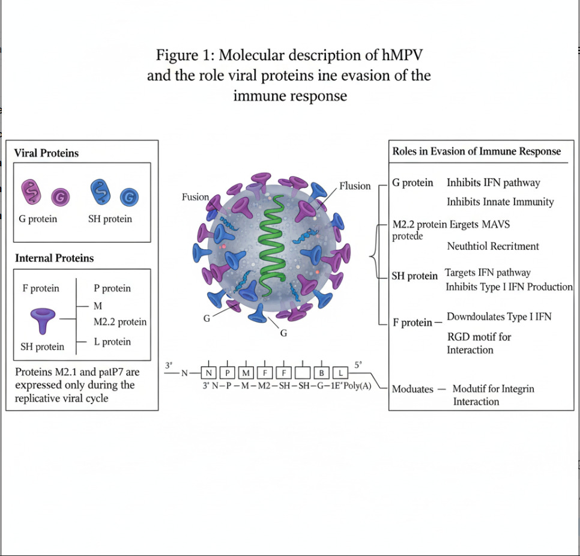

# 🦠 Human Metapneumovirus (HMPV): AI-Powered Diagnosis & Immune Evasion

## What this repository contains

- **`HMPV_Virus.ipynb`**: transfer-learning experiments on the small local sample of virus electron-microscopy (TEM) images in this repo: **Adenovirus (14), Cowpox (10) and Dengue (7), 31 micrographs in total**. Run it from the repo root.
- **`Adenovirus/`, `Cowpox/`, `Dengue/`**: that sample. The full source dataset has 22 virus classes (Adenovirus, Astrovirus, CCHF, Cowpox, Dengue, Ebola, Guanarito, Influenza, LCM, Lassa, Machupo, Marburg, Nipah virus, Norovirus, Orf, Papilloma, Pseudocowpox, Rift Valley, Rotavirus, Sapovirus, TBE and West Nile). **HMPV is not one of the classes**, and nothing here classifies HMPV or chest images.
- The sections further down are background reading on HMPV biology and AI in respiratory diagnostics, adapted from the linked Medium article. They are not results from this repository.

### Dataset and why the file counts differ

Each micrograph in the dataset is stored as **three files**: the image (`.tif`), a particle-position file (`<name>_particlepositions.txt`) and a tag file (`<name>.tif_tags.csv`). The sample here shows the pattern: 31 images, 31 position files and 31 tag files. A file listing of the dataset therefore counts about **three times** the number of images (for example, 852 images would appear as 2,556 files). The notebook uses **only the image files**; the position and tag files are never read.

## Current notebook (3-class local sample)

| Step | What it does |
|---|---|
| Split | One stratified 60 / 20 / 20 split of the image files into 18 train, 6 validation and 7 test images, with an assertion that no file appears in two sets |
| Training | Four ImageNet-pretrained models: MobileNetV2 (last 30 layers fine-tuned), MobileNetV2 (frozen), ResNet-50 (frozen), EfficientNetB0 + LSTM (frozen). Augmentation on training only, each model with its own `preprocess_input`, early stopping on validation loss |
| Test evaluation | Every model is evaluated on the held-out test images (no augmentation, `shuffle=False`) with accuracy, a 95% Wilson interval, and for MobileNetV2 (frozen) a classification report and confusion matrix |
| Cross-validation | Stratified 5-fold cross-validation of a logistic-regression probe on frozen MobileNetV2 features, so all 31 images are scored by a model that never saw them |

### Results

**Pending.** The notebook has been rewritten as described above and has not been run since. No accuracy is claimed for it. Run it and the printed test accuracies and cross-validated accuracy will be added here.

How to read the numbers when they exist: a 7-image test set cannot distinguish models (one image is about 14 points, and the 95% interval for a perfect 7 of 7 still starts near 65%), and the 31-image cross-validation is the more trustworthy figure. Chance level for 3 classes is about 33% (about 45% if always predicting Adenovirus).

The previous local run of this notebook scored 40% (2 of 5) on 5 validation images for every model, and its "test" generator used those same 5 images, so that run showed nothing and is superseded.

### What changed from the earlier notebook

- The test set was the same 5 images as validation; images are now split once into disjoint train, validation and test sets.
- ResNet-50 and EfficientNet were fed MobileNetV2-preprocessed images; each model now uses its own `preprocess_input`.
- The `evaluate_model` calls were commented out; all models are now evaluated on the test set.
- Added 5-fold cross-validation, because a single 7-image test set is too small to trust.
- Removed the UNet cell, which was trained on random noise (`tf.random.normal`) and produced no segmentation result.

## Earlier 22-class run (Google Colab)

An earlier version of the notebook (kept in the git history, commit `a4d1425`) trained on a pre-split Google Drive copy of the full dataset: **745 train, 248 validation and 252 test images (1,245 in total) across 22 classes**. Random guessing there is about 4.5%. Figures are from its full training logs.

| Model | Epochs run | Best epoch (lowest val. loss, weights restored) | Val. accuracy at best epoch | Peak val. accuracy |
|---|---|---|---|---|
| MobileNetV2, last 30 layers fine-tuned (Adam 1e-4) | 24 | 19 (loss 1.768, AUC 0.906) | 43.95% | 46.77% |
| MobileNetV2, frozen | 29 | 24 (loss 1.690) | 44.35% | 44.76% |
| ResNet-50, frozen | 30 (ran to the limit) | 29 (loss 2.546) | 21.77% | 23.39% |
| EfficientNetB0 + LSTM, frozen | 11 | 6 (loss 2.925) | 10.48% | 10.48% |

- EfficientNetB0 + LSTM is stuck at 10.48% (26 of 248 validation images, i.e. it predicts one class) and did not learn. The fine-tuned MobileNetV2 reached about 52-55% training accuracy (with dropout and augmentation) against about 44% validation, so even the best model is weak.
- **No test result exists for the 22-class run.** Its `evaluate_model` calls were commented out and its test generator used augmentation with `shuffle=True`. To obtain one, build the test generator without augmentation and with `shuffle=False`:
  ```python
  test_gen = ImageDataGenerator(preprocessing_function=preprocess_input)
  test_ds = test_gen.flow_from_directory(test_dir, target_size=IMG_SIZE, batch_size=BATCH_SIZE,
                                         class_mode='categorical', shuffle=False)
  CLASS_NAMES = list(test_ds.class_indices.keys())
  evaluate_model(model, "MobileNetV2")
  ```
- An even earlier README stated ">95% accuracy". That figure was never supported by any notebook output and has been removed.
- That version also had bugs now fixed or removed: `plot_history` contained an indented `model.fit(...)` call, and `predict_image` rescaled by 1/255 instead of using `preprocess_input`.

- 🚨 **Overview:**  
Human metapneumovirus (HMPV) is a leading cause of upper and lower respiratory tract infections. It poses a serious threat to children, the elderly, and immunocompromised individuals.

- 🧑‍⚕️ **Clinical Importance:**
The clinical severity escalates with comorbidities such as advanced age, chronic lung disease, cardiovascular issues, and weakened immunity. Early detection and risk stratification are essential for effective management.

- 🌍 **Epidemiology:**  
  HMPV is prevalent worldwide, with fluctuations in incidence and seasonal outbreaks. Regional studies show it can account for up to 10% of hospital admissions for acute respiratory illness.

- 🔬 **Immune Evasion:**  
  HMPV uses viral proteins (G, SH, M2.2, F) to evade host immune responses by inhibiting interferon pathways and sabotaging innate immunity. This enables viral persistence and increases disease burden.

- 🤖 **AI-Enabled Diagnostics (literature background):**  
  Published deep learning pipelines use architectures such as MobileNetV2, ResNet-50, UNet and LSTM for lung image segmentation, temporal progression modeling and virus classification. This repository's own experiments with these architectures are summarised above; they do not reach the accuracy reported in the literature.

- 🗂️ **Data Methodology:**  
  The imaging dataset is split into train, test, and validation sets. Preprocessing includes resizing, normalization, and augmentation, ensuring robust and unbiased model evaluation.

- 🏥 **Clinical Implementation:**  
  Published studies describe AI-powered diagnostics supporting real-time clinical decision-making and early identification of HMPV and related comorbidities such as pneumonia and ARDS. Nothing in this repository has been clinically validated.

- 🧠 **Multimodal Integration:**  
  Future pipelines aim to integrate clinical notes, lab results, and imaging data using attention mechanisms. This will enable holistic patient assessment and personalized management strategies.

- 🚀 **Deployment & Future Directions:**  
  Efficient deployment at the point of care is becoming possible with edge devices and federated learning. Continued validation and global multi-center studies are critical for improving outcomes.

## 🦠 Human Metapneumovirus (HMPV) Structure and Immune Evasion
- **Central Structure:**  
  The illustration shows the human metapneumovirus (hMPV) particle. The green spiral represents its RNA genome, which is surrounded by various viral and internal proteins embedded in the viral envelope.

- **Viral Proteins (Surface):**  
  - *G protein (purple):* Inhibits interferon (IFN) pathway and blocks innate immune responses, helping the virus evade detection.
  - *SH protein (blue):* Suppresses IFN signaling and inhibits the host's Type I IFN production.

- **Internal Proteins:**  
  - *F protein:* Facilitates fusion of the virus with host cell membranes and downregulates Type I IFN, aiding in viral entry and immune escape. Also contains RGD motif for interaction with host integrins.
  - *P, M, M2.2, L proteins:* Essential for replication and RNA synthesis during the viral cycle.  
  - Proteins M2.1 and palP7 are only expressed during active replication.

- **Genome Layout:**  
  - The RNA genome is organized: `3′ N—P—M—F—M2—SH—G—L 5′`, encoding all the above proteins for replication and immune evasion.

- **Roles in Immune Evasion:**  
  - *G protein:* Inhibits IFN and innate immunity pathways.
  - *M2.2 protein:* Disrupts MAVS signaling, recruits neutrophils.
  - *SH protein:* Halts antiviral responses.
  - *F protein:* Interacts with host cell integrins, facilitating immune modulation and infection.


## 📚 References

- [Human metapneumovirus infection and comorbid conditions]
- [Epidemiology and molecular detection surveys]
- [Deep learning chest imaging models for virus classification]
- [Hybrid model innovation (UNet, LSTM) for temporal modeling]
- [Clinical validation: Diagnostic accuracy]
- [Multimodal attention and data integration]
- [Generalizability and cohort study limitations]
- [Edge deployment and point-of-care studies]
- [Future directions in clinical informatics and predictive diagnostics]
- [NCBI – Human Metapneumovirus]

- Read the full article: [HMPV Virus on Medium](https://medium.com/@saivimenthanvl/hmpv-virus-177aad08d84a)
